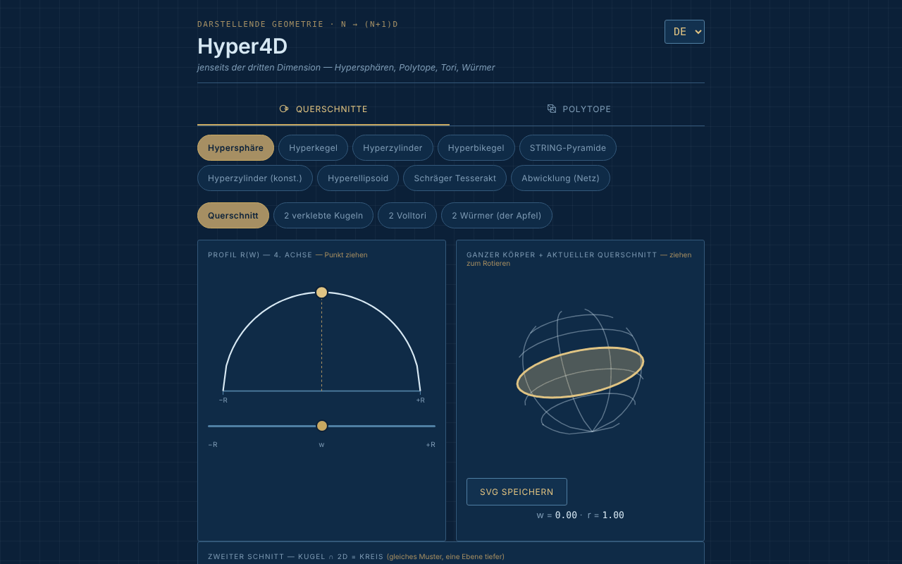

# Hyper4D

[English](README.md) · [Română](README.ro.md) · [Français](README.fr.md) · [Italiano](README.it.md) · [Español](README.es.md) · [Português](README.pt.md) · **Deutsch** · [Magyar](README.hu.md)

**Version:** 1.2.0 · **Zuletzt aktualisiert:** 2026-10-19

Oberflächensprachen: **Română, English, Français, Italiano, Español, Português (PT), Deutsch, Magyar**

Interaktiver Entdecker der Geometrie in der vierten Dimension: Schnitte von Hyperkörpern und Projektionen regulärer Polytope.

**Online-App:** https://chiuta.github.io/Hyper4D/

## Was es ist

Hyper4D ist eine Anwendung in einer einzigen Datei (`index.html`, SVG + JavaScript, ohne Bibliotheken) für die darstellende Geometrie „jenseits der dritten Dimension“, im Stil einer blauen technischen Zeichnung. Sie hat zwei Kategorien: **Querschnitte** (wie ein von einem 3D-Raum geschnittener 4D-Körper aussieht, wenn man die vierte Achse durchläuft) und **Polytope** (in Echtzeit gedrehte 4D → 3D → 2D-Projektionen).

## Funktionen

- **Querschnitte:** Hypersphäre, Hyperkegel, Hyperzylinder, Doppelhyperkegel (Bikonus), „STRING-Pyramide“, Hyperzylinder (Konstruktion), Hyperellipsoid, schiefer Tesserakt, Abwicklung (Netz). Das Profil r(w) mit einem per Maus gezogenen Punkt, der ganze Körper mit dem aktuellen Schnitt, der „zweite Schnitt“ (Kugel ∩ 2D = Kreis).
- Für die Hypersphäre Ansichten: Schnitt, „2 verklebte Kugeln“, „2 Volltori“, „2 Würmer (der Apfel)“ mit wählbarer Wurmanzahl.
- Für den schiefen Tesserakt: Schnittrichtungen Fläche / Kante / Ecke.
- **Polytope:** 5-Zeller, 8-Zeller, 16-Zeller, 24-Zeller, 600-Zeller, 120-Zeller; Duoprismen (3,3), (3,5) und benutzerdefiniert (P,Q); Pyramiden über Würfel, Oktaeder, Dodekaeder, Ikosaeder; „star skeleton“.
- Doppelte 4D-Rotation (Ebenen XW und YZ), perspektivische oder orthografische Projektion, Pause/Wiedergabe, Geschwindigkeit, „Solid faces“.
- Schriftfeld mit berechneten Werten (Körper, Ecken·Kanten·Flächen — je nach Sprache beschriftet V·M·F, S·A·F, V·E·F usw. —, Hypervolumen V₄, die Winkel ∠XW und ∠YZ).
- Euler-Prüfung für Polytope: `Ecken − Kanten + Flächen − Zellen = 0`, wobei Ecken und Kanten aus der gezeichneten Geometrie gezählt werden (auch für das benutzerdefinierte Duoprisma P×Q); bei Duoprismen werden auch die polygonalen Flächen der Grundkörper gezählt, nicht nur die quadratischen aus dem Schriftfeld. Für das Sternskelett wird sie nicht angezeigt.
- Tastenkürzel bei Polytopen: `P` oder `Leertaste` = Pause/Wiedergabe, `←` `→` = vorherige/nächste Form (Hinweis auf der Seite, in 8 Sprachen).
- Drehen durch Ziehen mit der Maus, Zoom mit dem Mausrad oder mit zwei Fingern.
- Schaltfläche „SVG speichern“ (bei Polytopen und bei „Ganzer Körper + aktueller Schnitt“): lädt das aktuelle Diagramm als eigenständige SVG-Datei herunter (die berechneten Stile werden in Attribute kopiert, mit dem Hintergrund der App), für Arbeiten oder Präsentationen; das geschieht lokal, ohne Netzwerk.
- Das Polytop-Diagramm hat nun eine Textalternative (`role="img"` mit Körper, V·M·F und einem Verweis auf das Schriftfeld), in 8 Sprachen.
- Oberfläche in 8 Sprachen: EN (Standard), RO, FR, IT, ES, PT, DE, HU.
- Der Zustand (Sprache, Kategorie, Form, Ansicht) spiegelt sich im URL-Hash wider und kann daher als Lesezeichen gesetzt oder geteilt werden.

## Neue Funktionen (1.1.0)

Bei **Polytopen**, unter dem Diagramm, eine neue Schaltflächenreihe (in den 7 Sprachen der App):
- **OBJ-Export (3D)**: die Ecken des Polytops in der 4D → 3D-Projektion im Moment des Drückens (die aktuelle Doppelrotation und der aktuelle Perspektiv-/Orthografik-Modus) und die Kanten als `l`-Linien. Lässt sich in Blender, MeshLab usw. öffnen (halte die Rotation an, damit du genau weißt, was du exportierst). Exportiert keine Flächen: Es sind nur die Linien (Skelett).
- **JSON-Export (4D)**: die 4D-Koordinaten (x, y, z, w), normiert auf den Umkugelradius 1, die Kanten und Flächen als Indizes (ab 0), plus die Anzahlen. Getestet: 8-Zeller = 16/32/24, 600-Zeller = 120/720, 120-Zeller = 600/1200 usw.
- **QR-Code**: Der Code enthält die öffentliche Adresse der App (`https://chiuta.github.io/Hyper4D/`; wenn die Seite von einem anderen HTTPS-Host ausgeliefert wird, die Adresse dieser Seite) plus den aktuellen Zustands-Hash (Sprache, Kategorie, Form, Ansicht). Nützlich, um auf dem Handy genau dieselbe Ansicht zu öffnen. Die Adresse lässt sich auch kopieren. Lokal erzeugt; erscheint nur, wenn das QR-Modul in der Datei enthalten ist.
- **Drucken**: Die Schaltfläche „Drucken“ (oder Strg+P) verwendet jetzt ein Stylesheet für Papier: weißer Hintergrund, dunkle Linien, ohne Reiter, Schaltflächen und Auswahlfelder. Früher wurde das dunkle Design gedruckt. Die Zeichnungen bleiben die vom Bildschirm (das genaue Aussehen gefüllter Flächen kann je nach Drucker von dem im Browser abweichen).

Die Sprachen der App sind EN, RO, FR, IT, ES, PT, DE, HU. Die neuen Übersetzungen in FR/IT/ES/PT/DE/HU sind maschinell, **nicht muttersprachlich geprüft**.

## Das „fff-kit“

In `index.html` eingefügte Module: `core`, `label`, `bundle`, `qr`. „Transparenz“ öffnet sich über die Version in der Fußzeile (Netzwerk: 0 externe Anfragen; es gibt keine Schlüssel in `localStorage`, die Sicherung ist daher leer). Ohne das Kit funktioniert die App genauso, nur ohne die QR-Schaltfläche.

## Tests

`node tests/fff-r8.test.mjs` (Playwright, Netzwerk gesperrt; 41 Prüfungen): Der OBJ-Export wird unabhängig mit der aus den JSON-Daten und den Winkeln im Schriftfeld berechneten 4D-Rotation verglichen (orthografisch und perspektivisch), Anzahlen für 5-Zeller…120-Zeller und Duoprismen, Kantenlänge des Tesserakts, QR zurückdekodiert, Beschriftungen in 8 Sprachen, Druckmodus (PDF), axe-core 0 Verstöße (einschließlich Dialog, beide Kategorien), 360 px, ohne das Kit.

## Bedienungsanleitung

1. Wähle die Sprache im Auswahlfeld in der Ecke der Kopfzeile (EN / RO / FR / IT / ES / PT / DE / HU).
2. Wähle die Kategorie: **Querschnitte** oder **Polytope**.
3. Bei den Schnitten: Wähle einen Körper (zum Beispiel „Hypersphäre“) und ziehe den Punkt auf dem Profil r(w) oder bewege den Regler `w`, um die vierte Achse zu durchlaufen; ziehe den Körper, um ihn zu drehen.
4. Aktiviere „Show the cut toward 2D“ (in der gewählten Sprache) für den zweiten Schnitt; probiere bei der Hypersphäre die Ansichten „2 verklebte Kugeln“, „2 Volltori“, „2 Würmer“.
5. Bei Polytopen: Wähle ein 4D-Polyeder, dann „Pause“/„Play“ für die Rotation, den Geschwindigkeitsregler und „Solid faces“ für gefüllte Flächen; wechsle zwischen perspektivischer und orthografischer Projektion.
6. Für das benutzerdefinierte Duoprisma wähle die Werte P und Q aus den Listen.
7. Kopiere die Adresse aus dem Browser, um genau den aktuellen Zustand zu teilen (Hash `#lang=…&cat=…&shape=…`).

## Datenschutz und Netzwerk

- Ich habe im Code keinen lokalen Speicher gefunden (auch nicht in 1.1.0: Die Exporte sind auf Anforderung heruntergeladene Dateien) (`localStorage`, `IndexedDB`), keine Cookies und keine Netzwerkaufrufe (`fetch`/XHR); es werden keine externen Skripte, Schriften oder Bilder geladen.
- Der Navigationszustand wird nur im URL-Hash gehalten (`replaceState`).
- Die einzige `http`-Adresse in der Datei ist der Standard-SVG-Namensraum (`www.w3.org`), ohne Verbindung.

## Lokale / Offline-Ausführung

Lade `index.html` herunter und öffne die Datei im Browser; sie funktioniert vollständig ohne Internet (die Fußzeile der App sagt: „Offline tool, no external dependencies“).

## Verlauf / Changelog

### 14. Oktober 2026 (v1.1.0)
- Neu bei Polytopen: OBJ- und JSON-Export, QR-Code des Zustands, Druck-Stylesheet; Fenster „Transparenz“ (fff-kit: core, label, bundle, qr); `tests/fff-r8.test.mjs`. CSP: Hash des Skripts neu berechnet.

### 12. Oktober 2026 (v1.0.0)
- 1.0.0 — 2026-10-12: Version und Datum der letzten Aktualisierung werden in der App angezeigt

### 11. Oktober 2026 (dritter Eintrag)
- SVG-Speicherung für das Polytop-Diagramm und für den ganzen Körper + Schnitt.
- Das Diagramm der rotierenden Projektion ist nicht mehr `aria-hidden`: Es hat eine Textbeschreibung (Körper, V·M·F), die bei Form- oder Sprachwechsel aktualisiert wird.

### 11. Oktober 2026 (zweiter Eintrag)
- Euler-Prüfung (V − E + F − C = 0) für konvexe Polytope, Tastenkürzel `P`/`Leertaste` und `←`/`→`, Schriftfeld-Beschriftung V·M·F in alle 7 Sprachen übersetzt (im Englischen ergab „M“ keinen Sinn), neue Übersetzungen in 7 Sprachen.
- CSP-Richtlinie: `script-src` mit Hash statt `'unsafe-inline'`.

### 11. Oktober 2026
- Barrierefreiheit: Der Arbeitsbereich ist in <main> eingefasst, die Kategorieleiste wurde zu einem `div`-Element mit der Rolle `tablist` (axe: 0 Verstöße).
- Strenge CSP hinzugefügt (ohne Netzwerk, ohne externe Ressourcen).

## Lizenz

MIT für den Code und die Struktur der App — siehe Datei `LICENSE`. Eventuell in die Datei eingebundene Bibliotheken von Drittanbietern behalten ihre eigenen Lizenzen.

## Autor

Alexio — Alexandru-Ionuț Chiuță, Kontakt: alexio@trom.tf.

## Zusammenfassung auf Englisch

Hyper4D ist ein SVG/JavaScript-Entdecker in einer einzigen Datei für die Geometrie in vier Dimensionen: Schnitte von Hypersphären, Hyperkegeln, Hyperzylindern, des schiefen Tesserakts und mehr, dazu rotierende 4D → 3D → 2D-Projektionen regulärer Polytope (vom 5-Zeller bis zum 120-Zeller), Duoprismen und Pyramiden. Oberfläche in 8 Sprachen, kein Speicher, kein Netzwerk. MIT-lizenziert.

Neu in 1.1.0 (Polytope): OBJ-Export der aktuellen 3D-Projektion (Drahtgitter), JSON-Export der 4D-Ecken/Kanten/Flächen, ein QR-Code für die aktuelle Ansicht (öffentliche Adresse + Zustands-Hash; lokal erzeugt) und ein papierfreundliches Druck-Stylesheet. Die Oberfläche hat 8 Sprachen (Ungarisch eingeschlossen); die neuen Zeichenfolgen in FR/IT/ES/PT/DE/HU sind maschinell übersetzt und nicht muttersprachlich geprüft.
