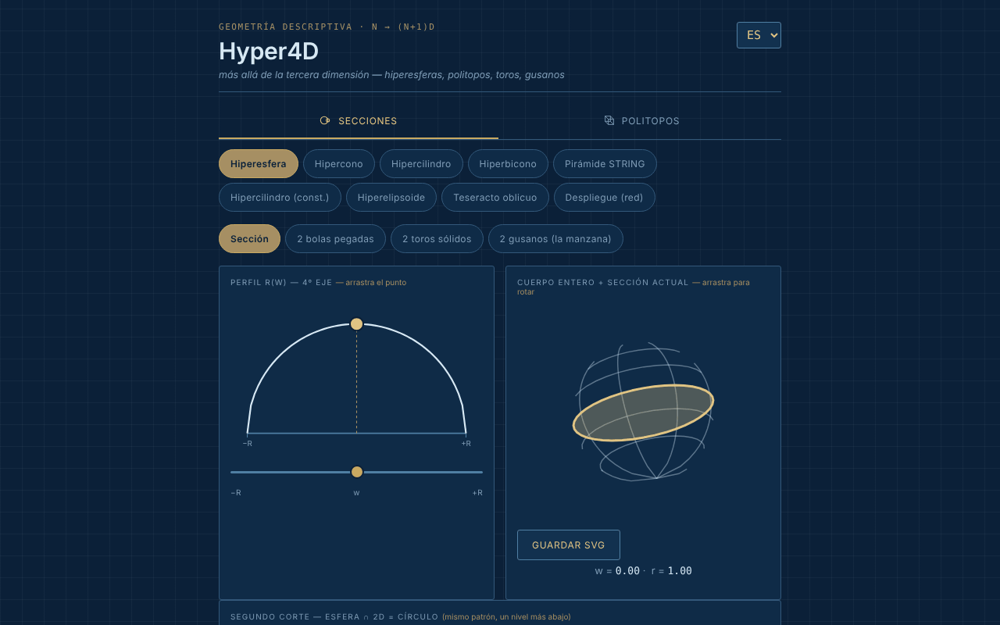

# Hyper4D

[English](README.md) · [Română](README.ro.md) · [Français](README.fr.md) · [Italiano](README.it.md) · **Español** · [Português](README.pt.md) · [Deutsch](README.de.md) · [Magyar](README.hu.md)

**Versión:** 2.0.0 · **Última actualización:** 2026-10-26

Idiomas de la interfaz: **Română, English, Français, Italiano, Español, Português (PT), Deutsch, Magyar**

Explorador interactivo de geometría en la cuarta dimensión: secciones de hipercuerpos y proyecciones de politopos regulares.

**Aplicación en línea:** https://chiuta.github.io/Hyper4D/

## Qué es

Hyper4D es una aplicación de un único archivo (`index.html`, SVG + JavaScript, sin bibliotecas) para la geometría descriptiva «más allá de la tercera dimensión», al estilo de un dibujo técnico azul. Tiene dos categorías: **Secciones transversales** (qué aspecto tiene un cuerpo 4D cortado por un espacio 3D, recorriendo el cuarto eje) y **Politopos** (proyecciones 4D → 3D → 2D rotadas en tiempo real).

## Funciones

- **Secciones transversales:** hiperesfera, hipercono, hipercilindro, hipercono doble (bicono), «Pirámide STRING», hipercilindro (construcción), hiperelipsoide, teseracto oblicuo, desarrollo (net). El perfil r(w) con un punto arrastrado con el ratón, el cuerpo entero con la sección actual, el «segundo corte» (esfera ∩ 2D = círculo).
- Para la hiperesfera, vistas: sección, «2 bolas pegadas», «2 toros macizos», «2 gusanos (la manzana)» con número de gusanos seleccionable.
- Para el teseracto oblicuo: direcciones de corte cara / arista / vértice.
- **Politopos:** 5-celdas, 8-celdas, 16-celdas, 24-celdas, 600-celdas, 120-celdas; duoprismas (3,3), (3,5) y (P,Q) personalizado; pirámides sobre el cubo, el octaedro, el dodecaedro, el icosaedro; «star skeleton».
- Doble rotación 4D (planos XW e YZ), proyección en perspectiva u ortográfica, pausa/reproducción, velocidad, «Solid faces».
- Cartela con valores calculados (cuerpo, vértices·aristas·caras — etiquetados V·M·F, S·A·F, V·E·F, etc., según el idioma —, hipervolumen V₄, los ángulos ∠XW y ∠YZ).
- Verificación de Euler para los politopos: `vértices − aristas + caras − celdas = 0`, con los vértices y las aristas contados a partir de la geometría dibujada (también para el duoprisma personalizado P×Q); para los duoprismas se cuentan además las caras poligonales de las bases, no solo las cuadradas de la cartela. No se muestra para el esqueleto en estrella.
- Atajos de teclado en Politopos: `P` o `Espacio` = pausa/reproducción, `←` `→` = forma anterior/siguiente (pista mostrada en la página, en 8 idiomas).
- Rotación arrastrando con el ratón, zoom con la rueda o con dos dedos.
- Botón «Guardar SVG» (en Politopos y en «Cuerpo entero + sección actual»): descarga el diagrama actual como archivo SVG autónomo (los estilos calculados se copian en atributos, con el fondo de la aplicación), para trabajos o presentaciones; se hace en local, sin red.
- El diagrama del politopo tiene ahora una alternativa de texto (`role="img"` con el cuerpo, V·M·F y una referencia a la cartela), en 8 idiomas.
- Interfaz en 8 idiomas: EN (predeterminado), RO, FR, IT, ES, PT, DE, HU.
- El estado (idioma, categoría, forma, vista) se refleja en el hash de la URL, por lo que se puede guardar como marcador o compartir.

## Novedades (1.1.0)

En **Politopos**, bajo el diagrama, una nueva fila de botones (en los 7 idiomas de la aplicación):
- **Exportación OBJ (3D)**: los vértices del politopo en la proyección 4D → 3D en el momento de pulsar (la doble rotación y el modo perspectiva/ortográfico actuales) y las aristas como líneas `l`. Se abre en Blender, MeshLab, etc. (pon la rotación en pausa para saber exactamente qué exportas). No exporta caras: son solo las líneas (esqueleto).
- **Exportación JSON (4D)**: las coordenadas 4D (x, y, z, w), normalizadas al radio circunscrito 1, las aristas y las caras como índices (desde 0), más los recuentos. Probado: 8-celdas = 16/32/24, 600-celdas = 120/720, 120-celdas = 600/1200, etc.
- **Código QR**: el código contiene la dirección pública de la aplicación (`https://chiuta.github.io/Hyper4D/`; cuando la página se sirve desde otro host HTTPS, la dirección de esa página) más el hash de estado actual (idioma, categoría, forma, vista). Útil para abrir en el teléfono exactamente la misma vista. También se puede copiar la dirección. Generado en local; solo aparece si el módulo QR está en el archivo.
- **Impresión**: el botón «Imprimir» (o Ctrl+P) usa ahora una hoja de estilo para papel: fondo blanco, líneas oscuras, sin pestañas, botones ni selectores. Antes se imprimía el tema oscuro. Los dibujos siguen siendo los de la pantalla (el aspecto exacto de las caras macizas puede diferir del del navegador, según la impresora).

Los idiomas de la aplicación son EN, RO, FR, IT, ES, PT, DE, HU. Las nuevas traducciones al FR/IT/ES/PT/DE/HU son automáticas, **sin verificación nativa**.

## El kit «fff-kit»

Módulos pegados en `index.html`: `core`, `label`, `bundle`, `qr`. «Transparencia» se abre desde la versión del pie de página (red: 0 solicitudes externas; no hay claves en `localStorage`, por lo que la copia de seguridad está vacía). Sin el kit, la aplicación funciona igual, pero sin el botón QR.

## Pruebas

`node tests/fff-r8.test.mjs` (Playwright, red bloqueada; 41 comprobaciones): la exportación OBJ se compara de forma independiente con la rotación 4D calculada a partir de los datos JSON y de los ángulos de la cartela (ortográfica y perspectiva), recuentos para 5-celdas…120-celdas y duoprismas, longitud de las aristas del teseracto, QR decodificado de vuelta, etiquetas en 8 idiomas, modo de impresión (PDF), axe-core 0 infracciones (incluido el cuadro de diálogo, ambas categorías), 360 px, sin el kit.

## Manual de uso

1. Elige el idioma en el selector de la esquina de la cabecera (EN / RO / FR / IT / ES / PT / DE / HU).
2. Elige la categoría: **Secciones transversales** o **Politopos**.
3. En las secciones: elige un cuerpo (por ejemplo «Hiperesfera») y arrastra el punto del perfil r(w) o mueve el control deslizante `w` para recorrer el cuarto eje; arrastra el cuerpo para rotarlo.
4. Marca «Show the cut toward 2D» (en el idioma elegido) para el segundo corte; en la hiperesfera prueba las vistas «2 bolas pegadas», «2 toros macizos», «2 gusanos».
5. En los politopos: elige un poliedro 4D y luego «Pause»/«Play» para la rotación, el control de velocidad y «Solid faces» para las caras macizas; alterna entre proyección en perspectiva y ortográfica.
6. Para el duoprisma personalizado, elige los valores P y Q de las listas.
7. Copia la dirección del navegador para compartir exactamente el estado actual (hash `#lang=…&cat=…&shape=…`).

## Privacidad y red

- No he encontrado en el código almacenamiento local (ni siquiera en la 1.1.0: las exportaciones son archivos descargados a petición) (`localStorage`, `IndexedDB`), cookies ni llamadas de red (`fetch`/XHR); no se cargan scripts, fuentes ni imágenes externos.
- El estado de navegación solo se guarda en el hash de la URL (`replaceState`).
- La única dirección `http` del archivo es el espacio de nombres SVG estándar (`www.w3.org`), sin conexión.

## Ejecución local / sin conexión

Descarga `index.html` y ábrelo en el navegador; funciona completamente sin internet (el pie de la aplicación dice: «Offline tool, no external dependencies»).

## Historial / Changelog

### 1.2.7 — 2026-10-23

- Auditoría fff-kit 1.2.0: el aviso de paridad i18n es un falso positivo (las claves se completan en tiempo de ejecución); documentado como excepción justificada en `fff.config.json`. Sin cambios funcionales.

### 1.2.5 — 2026-10-22

fff-kit 1.1.4: áreas táctiles y texto mínimo. Áreas táctiles/texto corregidos en la aplicación.

### 1.2.4 — 2026-10-22

fff-kit 1.1.2: PBKDF2 con 600.000 iteraciones, protección anti-clickjacking.

### 1.2.3 — 2026-10-22
- Móvil: el texto mide al menos 12 px y los botones y campos tienen áreas táctiles mayores en pantallas estrechas.
- El botón «Buy Me a Coffee» ya no flota sobre los controles; está al final de la página.

### 1.2.2 — 2026-10-22
- Corrección de traducción: la descripción (y el nombre) del panel de transparencia siguen ahora el idioma de la interfaz.

### 1.2.1 — 2026-10-22
- La etiqueta de la zona de las bolas pegadas (polos, ecuador, hacia A/B) ahora está traducida y se actualiza al cambiar de idioma.

### 14 de octubre de 2026 (v1.1.0)
- Novedad en Politopos: exportación OBJ y JSON, código QR del estado, hoja de estilo de impresión; ventana «Transparencia» (fff-kit: core, label, bundle, qr); `tests/fff-r8.test.mjs`. CSP: hash del script recalculado.

### 12 de octubre de 2026 (v1.0.0)
- 1.0.0 — 2026-10-12: la versión y la fecha de la última actualización se muestran en la aplicación

### 11 de octubre de 2026 (tercera entrada)
- Guardado SVG para el diagrama del politopo y para el cuerpo entero + sección.
- El diagrama de la proyección rotatoria ya no es `aria-hidden`: tiene una descripción de texto (cuerpo, V·M·F), actualizada al cambiar la forma o el idioma.

### 11 de octubre de 2026 (segunda entrada)
- Verificación de Euler (V − E + F − C = 0) para los politopos convexos, atajos de teclado `P`/`Espacio` y `←`/`→`, etiqueta V·M·F de la cartela traducida a los 7 idiomas (en inglés «M» no tenía sentido), nuevas traducciones en 7 idiomas.
- Política CSP: `script-src` con hash en lugar de `'unsafe-inline'`.

### 11 de octubre de 2026
- Accesibilidad: la zona de trabajo se encierra en <main>, la barra de categorías pasó a ser un elemento `div` con el rol `tablist` (axe: 0 infracciones).
- Añadida una CSP estricta (sin red, sin recursos externos).

## Licencia

MIT para el código y la estructura de la aplicación — véase el archivo `LICENSE`. Las eventuales bibliotecas de terceros incluidas en el archivo conservan sus propias licencias.

## Autor

Alexio — Alexandru-Ionuț Chiuță, contacto: alexio@trom.tf.

## Resumen

Hyper4D es un explorador SVG/JavaScript de un único archivo de la geometría de cuatro dimensiones: secciones de hiperesferas, hiperconos, hipercilindros, del teseracto oblicuo y más, además de proyecciones 4D → 3D → 2D rotatorias de politopos regulares (del 5-celdas al 120-celdas), duoprismas y pirámides. Interfaz en 8 idiomas, sin almacenamiento, sin red. Licencia MIT.

Novedades en la 1.1.0 (Politopos): exportación OBJ de la proyección 3D actual (alambre), exportación JSON de los vértices/aristas/caras 4D, código QR de la vista actual (dirección pública + hash de estado; generado en local) y una hoja de estilo de impresión adecuada para papel. La interfaz tiene 8 idiomas (húngaro incluido); las nuevas cadenas en FR/IT/ES/PT/DE/HU están traducidas automáticamente y no han sido verificadas por hablantes nativos.
