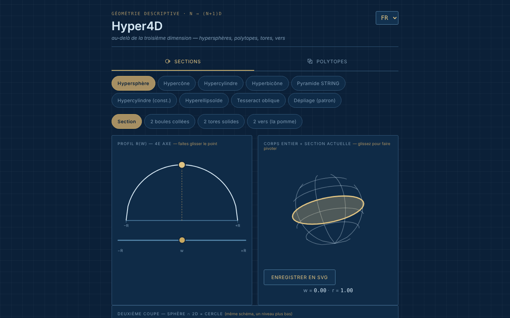

# Hyper4D

[English](README.md) · [Română](README.ro.md) · **Français** · [Italiano](README.it.md) · [Español](README.es.md) · [Português](README.pt.md) · [Deutsch](README.de.md) · [Magyar](README.hu.md)

**Version :** 1.2.0 · **Dernière mise à jour :** 2026-10-19

Langues de l'interface : **Română, English, Français, Italiano, Español, Português (PT), Deutsch, Magyar**

Explorateur interactif de géométrie en quatrième dimension : sections d'hypercorps et projections de polytopes réguliers.

**Application en ligne :** https://chiuta.github.io/Hyper4D/

## Ce que c'est

Hyper4D est une application en un seul fichier (`index.html`, SVG + JavaScript, sans bibliothèques) pour la géométrie descriptive « au-delà de la troisième dimension », dans le style d'un dessin technique bleu. Elle comporte deux catégories : **Sections transversales** (à quoi ressemble un corps 4D coupé par un espace 3D, en parcourant le quatrième axe) et **Polytopes** (projections 4D → 3D → 2D tournant en temps réel).

## Fonctionnalités

- **Sections transversales :** hypersphère, hypercône, hypercylindre, hypercône double (bicône), « Pyramide STRING », hypercylindre (construction), hyperellipsoïde, tesseract oblique, dépliage (patron). Le profil r(w) avec un point déplacé à la souris, le corps entier avec la section courante, la « deuxième coupe » (sphère ∩ 2D = cercle).
- Pour l'hypersphère, vues : section, « 2 boules collées », « 2 tores pleins », « 2 vers (la pomme) » avec un nombre de vers sélectionnable.
- Pour le tesseract oblique : directions de coupe face / arête / sommet.
- **Polytopes :** 5-cellules, 8-cellules, 16-cellules, 24-cellules, 600-cellules, 120-cellules ; duoprismes (3,3), (3,5) et (P,Q) personnalisé ; pyramides sur le cube, l'octaèdre, le dodécaèdre, l'icosaèdre ; « star skeleton ».
- Double rotation 4D (plans XW et YZ), projection en perspective ou orthographique, pause/lecture, vitesse, « Solid faces ».
- Cartouche avec des valeurs calculées (corps, sommets·arêtes·faces — étiquetés V·M·F, S·A·F, V·E·F, etc. selon la langue —, hypervolume V₄, angles ∠XW et ∠YZ).
- Vérification d'Euler pour les polytopes : `sommets − arêtes + faces − cellules = 0`, avec les sommets et les arêtes comptés à partir de la géométrie dessinée (y compris pour le duoprisme personnalisé P×Q) ; pour les duoprismes, on compte aussi les faces polygonales des bases, et pas seulement les faces carrées du cartouche. Elle n'est pas affichée pour le squelette en étoile.
- Raccourcis clavier pour les Polytopes : `P` ou `Espace` = pause/lecture, `←` `→` = forme précédente/suivante (indice affiché dans la page, en 8 langues).
- Rotation par glissement à la souris, zoom à la molette ou à deux doigts.
- Bouton « Enregistrer SVG » (pour les Polytopes et pour « Corps entier + section courante ») : télécharge le diagramme courant sous forme de fichier SVG autonome (les styles calculés sont copiés dans des attributs, avec le fond de l'application), pour des travaux ou des présentations ; cela se fait en local, sans réseau.
- Le diagramme du polytope dispose désormais d'une alternative textuelle (`role="img"` avec le corps, V·M·F et un renvoi au cartouche), en 8 langues.
- Interface en 8 langues : EN (par défaut), RO, FR, IT, ES, PT, DE, HU.
- L'état (langue, catégorie, forme, vue) se reflète dans le hash de l'URL ; il peut donc être mis en favori ou partagé.

## Nouveautés (1.1.0)

Dans **Polytopes**, sous le diagramme, une nouvelle rangée de boutons (dans les 7 langues de l'application) :
- **Export OBJ (3D)** : les sommets du polytope dans la projection 4D → 3D au moment de l'appui (la double rotation et le mode perspective/orthographique courants) et les arêtes sous forme de lignes `l`. S'ouvre dans Blender, MeshLab, etc. (mettez la rotation en pause pour savoir exactement ce que vous exportez). N'exporte pas les faces : ce ne sont que les lignes (squelette).
- **Export JSON (4D)** : les coordonnées 4D (x, y, z, w), normalisées au rayon circonscrit 1, les arêtes et les faces sous forme d'indices (à partir de 0), plus les décomptes. Testé : 8-cellules = 16/32/24, 600-cellules = 120/720, 120-cellules = 600/1200, etc.
- **Code QR** : le code contient l'adresse publique de l'application (`https://chiuta.github.io/Hyper4D/` ; lorsque la page est servie depuis un autre hôte HTTPS, l'adresse de cette page) plus le hash d'état courant (langue, catégorie, forme, vue). Utile pour ouvrir exactement la même vue sur un téléphone. On peut aussi copier l'adresse. Généré en local ; n'apparaît que si le module QR est dans le fichier.
- **Impression** : le bouton « Imprimer » (ou Ctrl+P) utilise désormais une feuille de style pour le papier : fond blanc, lignes sombres, sans onglets, boutons ni sélecteurs. Auparavant, le thème sombre était imprimé. Les dessins restent ceux de l'écran (l'aspect exact des faces pleines peut différer de celui du navigateur, selon l'imprimante).

Les langues de l'application sont EN, RO, FR, IT, ES, PT, DE, HU. Les nouvelles traductions en FR/IT/ES/PT/DE/HU sont automatiques, **non vérifiées par des locuteurs natifs**.

## Le kit « fff-kit »

Modules collés dans `index.html` : `core`, `label`, `bundle`, `qr`. « Transparence » s'ouvre depuis la version dans le pied de page (réseau : 0 requête externe ; il n'y a aucune clé dans `localStorage`, la sauvegarde est donc vide). Sans le kit, l'application fonctionne de la même façon, mais sans le bouton QR.

## Tests

`node tests/fff-r8.test.mjs` (Playwright, réseau bloqué ; 41 vérifications) : l'export OBJ est comparé indépendamment à la rotation 4D calculée à partir des données JSON et des angles du cartouche (orthographique et perspective), décomptes pour 5-cellules…120-cellules et duoprismes, longueur des arêtes du tesseract, QR décodé en retour, étiquettes dans 8 langues, mode impression (PDF), axe-core 0 violation (y compris la boîte de dialogue, les deux catégories), 360 px, sans le kit.

## Mode d'emploi

1. Choisissez la langue dans le sélecteur situé dans le coin de l'en-tête (EN / RO / FR / IT / ES / PT / DE / HU).
2. Choisissez la catégorie : **Sections transversales** ou **Polytopes**.
3. Pour les sections : choisissez un corps (par exemple « Hypersphère ») et faites glisser le point sur le profil r(w) ou déplacez le curseur `w` pour parcourir le quatrième axe ; faites glisser le corps pour le faire tourner.
4. Cochez « Show the cut toward 2D » (dans la langue choisie) pour la deuxième coupe ; pour l'hypersphère, essayez les vues « 2 boules collées », « 2 tores pleins », « 2 vers ».
5. Pour les polytopes : choisissez un polyèdre 4D, puis « Pause »/« Play » pour la rotation, le curseur de vitesse et « Solid faces » pour les faces pleines ; basculez entre la projection en perspective et orthographique.
6. Pour le duoprisme personnalisé, choisissez les valeurs P et Q dans les listes.
7. Copiez l'adresse depuis le navigateur pour partager exactement l'état courant (hash `#lang=…&cat=…&shape=…`).

## Confidentialité et réseau

- Je n'ai trouvé dans le code aucun stockage local (pas même dans la 1.1.0 : les exports sont des fichiers téléchargés à la demande) (`localStorage`, `IndexedDB`), aucun cookie ni appel réseau (`fetch`/XHR) ; aucun script, police ou image externe n'est chargé.
- L'état de navigation n'est conservé que dans le hash de l'URL (`replaceState`).
- La seule adresse `http` du fichier est l'espace de noms SVG standard (`www.w3.org`), sans connexion.

## Exécution locale / hors ligne

Téléchargez `index.html` et ouvrez-le dans le navigateur ; il fonctionne entièrement sans internet (le pied de page de l'application indique : « Offline tool, no external dependencies »).

## Historique / Changelog

### 14 octobre 2026 (v1.1.0)
- Nouveau dans Polytopes : export OBJ et JSON, code QR de l'état, feuille de style d'impression ; fenêtre « Transparence » (fff-kit : core, label, bundle, qr) ; `tests/fff-r8.test.mjs`. CSP : hachage du script recalculé.

### 12 octobre 2026 (v1.0.0)
- 1.0.0 — 2026-10-12 : la version et la date de la dernière mise à jour sont affichées dans l'application

### 11 octobre 2026 (troisième entrée)
- Enregistrement SVG pour le diagramme du polytope et pour le corps entier + section.
- Le diagramme de la projection rotative n'est plus `aria-hidden` : il dispose d'une description textuelle (corps, V·M·F), mise à jour lors du changement de forme ou de langue.

### 11 octobre 2026 (deuxième entrée)
- Vérification d'Euler (V − E + F − C = 0) pour les polytopes convexes, raccourcis clavier `P`/`Espace` et `←`/`→`, étiquette V·M·F du cartouche traduite dans les 7 langues (en anglais, « M » n'avait pas de sens), nouvelles traductions dans 7 langues.
- Politique CSP : `script-src` avec hachage au lieu de `'unsafe-inline'`.

### 11 octobre 2026
- Accessibilité : la zone de travail est encadrée par <main>, la barre de catégories est devenue un élément `div` avec le rôle `tablist` (axe : 0 violation).
- Ajout d'une CSP stricte (sans réseau, sans ressources externes).

## Licence

MIT pour le code et la structure de l'application — voir le fichier `LICENSE`. Les éventuelles bibliothèques tierces incluses dans le fichier conservent leurs propres licences.

## Auteur

Alexio — Alexandru-Ionuț Chiuță, contact : alexio@trom.tf.

## Résumé
Hyper4D est un explorateur SVG/JavaScript en un seul fichier de la géométrie à quatre dimensions : sections d'hypersphères, d'hypercônes, d'hypercylindres, du tesseract oblique et plus encore, ainsi que des projections 4D → 3D → 2D rotatives de polytopes réguliers (du 5-cellules au 120-cellules), de duoprismes et de pyramides. Interface en 8 langues, sans stockage, sans réseau. Sous licence MIT.

Nouveau dans la 1.1.0 (Polytopes) : export OBJ de la projection 3D courante (fil de fer), export JSON des sommets/arêtes/faces 4D, code QR de la vue courante (adresse publique + hash d'état ; généré en local) et feuille de style d'impression adaptée au papier. L'interface compte 8 langues (hongrois inclus) ; les nouvelles chaînes en FR/IT/ES/PT/DE/HU sont traduites automatiquement et non vérifiées par des locuteurs natifs.
