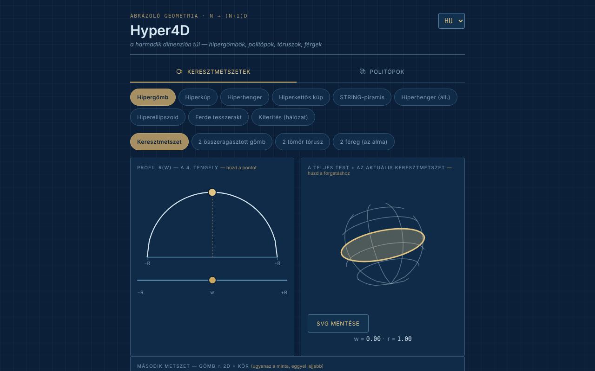

# Hyper4D

[English](README.md) · [Română](README.ro.md) · [Français](README.fr.md) · [Italiano](README.it.md) · [Español](README.es.md) · [Português](README.pt.md) · [Deutsch](README.de.md) · **Magyar**

**Verzió:** 1.2.4 · **Utolsó frissítés:** 2026-10-22

A felület nyelvei: **Română, English, Français, Italiano, Español, Português (PT), Deutsch, Magyar**

Interaktív felfedező a negyedik dimenzió geometriájához: hypertestek metszetei és szabályos politópok vetületei.

**Online alkalmazás:** https://chiuta.github.io/Hyper4D/

## Mi ez

A Hyper4D egyetlen fájlból álló alkalmazás (`index.html`, SVG + JavaScript, könyvtárak nélkül) az ábrázoló geometriához „a harmadik dimenzión túl”, kék műszaki rajz stílusában. Két kategóriája van: **Keresztmetszetek** (hogyan néz ki egy 3D-s térrel elmetszett 4D-s test, miközben végigjárjuk a negyedik tengelyt) és **Politópok** (valós időben forgatott 4D → 3D → 2D vetületek).

## Funkciók

- **Keresztmetszetek:** hipergömb, hiperkúp, hiperhenger, kettős hiperkúp (bikúp), „STRING-piramis”, hiperhenger (szerkesztés), hiperellipszoid, ferde tesszerakt, kiterítés (hálózat). Az r(w) profil egérrel húzott ponttal, az egész test az aktuális metszettel, a „második vágás” (gömb ∩ 2D = kör).
- A hipergömbhöz nézetek: metszet, „2 összeragasztott golyó”, „2 tömör tórusz”, „2 féreg (az alma)” kiválasztható féregszámmal.
- A ferde tesszerakthoz: vágási irányok lap / él / csúcs.
- **Politópok:** 5-cella, 8-cella, 16-cella, 24-cella, 600-cella, 120-cella; duoprizmák (3,3), (3,5) és egyéni (P,Q); piramisok a kocka, az oktaéder, a dodekaéder, az ikozaéder felett; „star skeleton”.
- Kettős 4D-forgatás (XW és YZ síkok), perspektivikus vagy ortografikus vetítés, szünet/lejátszás, sebesség, „Solid faces”.
- Címtábla a kiszámított értékekkel (test, csúcsok·élek·lapok — nyelvtől függően V·M·F, S·A·F, V·E·F stb. jelöléssel —, hipertérfogat V₄, a ∠XW és ∠YZ szögek).
- Euler-ellenőrzés a politópokhoz: `csúcsok − élek + lapok − cellák = 0`, a csúcsok és élek megszámlálása a megrajzolt geometriából történik (az egyéni P×Q duoprizmára is); a duoprizmáknál az alapok soklapú lapjait is megszámoljuk, nem csak a címtáblán szereplő négyzetes lapokat. A csillagvázhoz nem jelenik meg.
- Billentyűparancsok a Politópoknál: `P` vagy `Szóköz` = szünet/lejátszás, `←` `→` = előző/következő alakzat (a súgó az oldalon látható, 8 nyelven).
- Forgatás egérrel való húzással, nagyítás görgővel vagy két ujjal.
- „SVG mentése” gomb (a Politópoknál és az „Egész test + aktuális metszet” nézetnél): önálló SVG-fájlként letölti az aktuális diagramot (a számított stílusokat attribútumokba másolja, az alkalmazás hátterével), dolgozatokhoz vagy előadásokhoz; helyben történik, hálózat nélkül.
- A politóp diagramja mostantól szöveges alternatívával rendelkezik (`role="img"` a testtel, V·M·F-fel és a címtáblára való utalással), 8 nyelven.
- Felület 8 nyelven: EN (alapértelmezett), RO, FR, IT, ES, PT, DE, HU.
- Az állapot (nyelv, kategória, alakzat, nézet) megjelenik az URL hash-ében, így könyvjelzőzhető vagy megosztható.

## Újdonságok (1.1.0)

A **Politópoknál**, a diagram alatt, a gombok új sora (az alkalmazás 7 nyelvén):
- **OBJ-export (3D)**: a politóp csúcsai a megnyomás pillanatában érvényes 4D → 3D vetületben (az aktuális kettős forgatás és perspektivikus/ortografikus mód), az élek pedig `l` vonalakként. Megnyitható Blenderben, MeshLabban stb. (állítsd szüneteltetésre a forgatást, hogy pontosan tudd, mit exportálsz). Lapokat nem exportál: csak a vonalakat (váz).
- **JSON-export (4D)**: a 4D-s koordináták (x, y, z, w), a köréírt sugár 1-re normálva, az élek és lapok indexekként (0-tól), valamint a darabszámok. Tesztelve: 8-cella = 16/32/24, 600-cella = 120/720, 120-cella = 600/1200 stb.
- **QR-kód**: a kód az alkalmazás nyilvános címét tartalmazza (`https://chiuta.github.io/Hyper4D/`; ha az oldalt más HTTPS-gazdagép szolgálja ki, annak az oldalnak a címét) és az aktuális állapot-hash-t (nyelv, kategória, alakzat, nézet). Hasznos, hogy telefonon pontosan ugyanazt a nézetet nyisd meg. A cím másolható is. Helyben generálódik; csak akkor jelenik meg, ha a QR-modul a fájlban van.
- **Nyomtatás**: a „Nyomtatás” gomb (vagy Ctrl+P) mostantól papírra szabott stíluslapot használ: fehér háttér, sötét vonalak, fülek, gombok és választók nélkül. Korábban a sötét téma nyomtatódott. A rajzok ugyanazok maradnak, mint a képernyőn (a tömör lapok pontos megjelenése a nyomtatótól függően eltérhet a böngészőbelitől).

Az alkalmazás nyelvei: EN, RO, FR, IT, ES, PT, DE, HU. Az új FR/IT/ES/PT/DE/HU fordítások gépiek, **anyanyelvi ellenőrzés nélkül**.

## Az „fff-kit”

Az `index.html`-be beillesztett modulok: `core`, `label`, `bundle`, `qr`. Az „Átláthatóság” a láblécben lévő verzióból nyílik meg (hálózat: 0 külső kérés; nincsenek kulcsok a `localStorage`-ban, ezért a biztonsági mentés üres). A készlet nélkül az alkalmazás ugyanúgy működik, de QR-gomb nélkül.

## Tesztek

`node tests/fff-r8.test.mjs` (Playwright, letiltott hálózat; 41 ellenőrzés): az OBJ-export függetlenül össze van vetve a JSON-adatokból és a címtábla szögeiből számított 4D-s forgatással (ortografikus és perspektivikus), darabszámok az 5-cellától a 120-celláig és a duoprizmákra, a tesszerakt élhossza, visszadekódolt QR, címkék 8 nyelven, nyomtatási mód (PDF), axe-core 0 szabálysértés (a párbeszédablakot is beleértve, mindkét kategória), 360 px, a készlet nélkül.

## Használati útmutató

1. Válaszd ki a nyelvet a fejléc sarkában lévő választóból (EN / RO / FR / IT / ES / PT / DE / HU).
2. Válaszd ki a kategóriát: **Keresztmetszetek** vagy **Politópok**.
3. A metszeteknél: válassz egy testet (például „Hipergömb”), és húzd az r(w) profilon lévő pontot, vagy mozgasd a `w` csúszkát a negyedik tengely bejárásához; húzd a testet a forgatásához.
4. Jelöld be a „Show the cut toward 2D” opciót (a kiválasztott nyelven) a második vágáshoz; a hipergömbnél próbáld ki a „2 összeragasztott golyó”, „2 tömör tórusz”, „2 féreg” nézeteket.
5. A politópoknál: válassz egy 4D-s poliédert, majd „Pause”/„Play” a forgatáshoz, a sebességcsúszkát és a „Solid faces” opciót a tömör lapokhoz; válts a perspektivikus és az ortografikus vetítés között.
6. Az egyéni duoprizmához válaszd ki a P és Q értékeket a listákból.
7. Másold ki a böngésző címét, hogy pontosan az aktuális állapotot oszd meg (hash: `#lang=…&cat=…&shape=…`).

## Adatvédelem és hálózat

- A kódban nem találtam helyi tárolást (még az 1.1.0-ban sem: az exportok kérésre letöltött fájlok) (`localStorage`, `IndexedDB`), sütiket vagy hálózati hívásokat (`fetch`/XHR); nem töltődnek be külső szkriptek, betűtípusok vagy képek.
- A navigációs állapot csak az URL hash-ében marad meg (`replaceState`).
- Az egyetlen `http` cím a fájlban a szabványos SVG-névtér (`www.w3.org`), kapcsolat nélkül.

## Helyi / offline futtatás

Töltsd le az `index.html` fájlt, és nyisd meg böngészőben; teljesen internet nélkül működik (az alkalmazás lábléce ezt mondja: „Offline tool, no external dependencies”).

## Előzmények / Changelog

### 1.2.4 — 2026-10-22

fff-kit 1.1.2: PBKDF2 600 000 iterációval, clickjacking elleni védelem.

### 1.2.3 — 2026-10-22
- Mobil: a szöveg legalább 12 px, a gombok és mezők érintési felülete pedig nagyobb keskeny képernyőn.
- A „Buy Me a Coffee” gomb már nem lebeg a vezérlők fölött, hanem az oldal végén található.

### 1.2.2 — 2026-10-22
- Fordítási javítás: az átláthatósági panel leírása (és neve) mostantól a felület nyelvét követi.

### 1.2.1 — 2026-10-22
- Az összeragasztott golyók zónájának felirata (pólusok, egyenlítő, A/B felé) mostantól le van fordítva, és nyelvváltáskor frissül.

### 2026. október 14. (v1.1.0)
- Új a Politópoknál: OBJ- és JSON-export, az állapot QR-kódja, nyomtatási stíluslap; „Átláthatóság” ablak (fff-kit: core, label, bundle, qr); `tests/fff-r8.test.mjs`. CSP: a szkript hash-e újraszámolva.

### 2026. október 12. (v1.0.0)
- 1.0.0 — 2026-10-12: a verzió és az utolsó frissítés dátuma megjelenik az alkalmazásban

### 2026. október 11. (harmadik bejegyzés)
- SVG-mentés a politóp diagramjához és az egész test + metszet nézethez.
- A forgó vetület diagramja már nem `aria-hidden`: szöveges leírása van (test, V·M·F), amely az alakzat vagy a nyelv váltásakor frissül.

### 2026. október 11. (második bejegyzés)
- Euler-ellenőrzés (V − E + F − C = 0) a konvex politópokhoz, `P`/`Szóköz` és `←`/`→` billentyűparancsok, a címtábla V·M·F címkéje mind a 7 nyelvre lefordítva (angolul az „M” nem volt értelmes), új fordítások 7 nyelven.
- CSP-szabályzat: `script-src` hash-sel az `'unsafe-inline'` helyett.

### 2026. október 11.
- Akadálymentesség: a munkaterület <main> elembe került, a kategóriasáv `div` elemmé vált `tablist` szereppel (axe: 0 szabálysértés).
- Szigorú CSP hozzáadva (hálózat és külső erőforrások nélkül).

## Licenc

MIT az alkalmazás kódjára és szerkezetére — lásd a `LICENSE` fájlt. A fájlba esetlegesen beépített harmadik féltől származó könyvtárak megtartják saját licencüket.

## Szerző

Alexio — Alexandru-Ionuț Chiuță, kapcsolat: alexio@trom.tf.

## Összefoglaló
A Hyper4D egyetlen fájlból álló SVG/JavaScript felfedező a négydimenziós geometriához: hipergömbök, hiperkúpok, hiperhengerek, a ferde tesszerakt és mások metszetei, valamint szabályos politópok (az 5-cellától a 120-celláig), duoprizmák és piramisok forgó 4D → 3D → 2D vetületei. Felület 8 nyelven, tárolás és hálózat nélkül. MIT-licenc.

Újdonság az 1.1.0-ban (Politópok): az aktuális 3D vetület OBJ-exportja (drótváz), a 4D csúcsok/élek/lapok JSON-exportja, az aktuális nézet QR-kódja (nyilvános cím + állapot-hash; helyben generálva) és egy papírbarát nyomtatási stíluslap. A felület 8 nyelvű (a magyarral együtt); az új FR/IT/ES/PT/DE/HU szövegek gépi fordítások, anyanyelvi beszélők által nem ellenőrizve.
