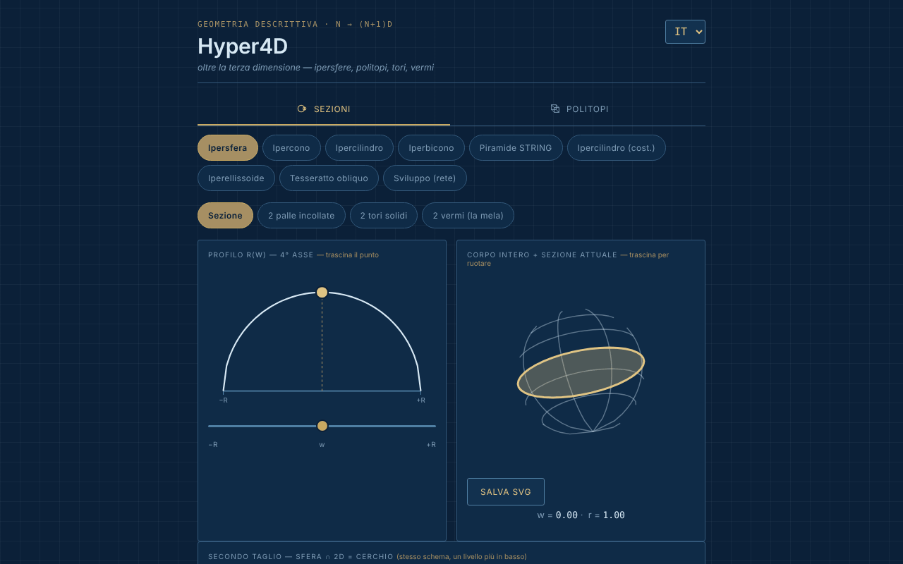

# Hyper4D

[English](README.md) · [Română](README.ro.md) · [Français](README.fr.md) · **Italiano** · [Español](README.es.md) · [Português](README.pt.md) · [Deutsch](README.de.md) · [Magyar](README.hu.md)

**Versione:** 1.2.0 · **Ultimo aggiornamento:** 2026-10-19

Lingue dell'interfaccia: **Română, English, Français, Italiano, Español, Português (PT), Deutsch, Magyar**

Esploratore interattivo di geometria nella quarta dimensione: sezioni di ipercorpi e proiezioni di politopi regolari.

**Applicazione online:** https://chiuta.github.io/Hyper4D/

## Che cos'è

Hyper4D è un'applicazione in un unico file (`index.html`, SVG + JavaScript, senza librerie) per la geometria descrittiva «oltre la terza dimensione», nello stile di un disegno tecnico blu. Ha due categorie: **Sezioni trasversali** (come appare un corpo 4D tagliato da uno spazio 3D, percorrendo il quarto asse) e **Politopi** (proiezioni 4D → 3D → 2D ruotate in tempo reale).

## Funzioni

- **Sezioni trasversali:** ipersfera, ipercono, ipercilindro, ipercono doppio (bicono), «Piramide STRING», ipercilindro (costruzione), iperellissoide, tesseratto obliquo, sviluppo (net). Il profilo r(w) con un punto trascinato dal mouse, il corpo intero con la sezione corrente, il «secondo taglio» (sfera ∩ 2D = cerchio).
- Per l'ipersfera, visualizzazioni: sezione, «2 palle incollate», «2 tori pieni», «2 vermi (la mela)» con numero di vermi selezionabile.
- Per il tesseratto obliquo: direzioni di taglio faccia / spigolo / vertice.
- **Politopi:** 5-celle, 8-celle, 16-celle, 24-celle, 600-celle, 120-celle; duoprismi (3,3), (3,5) e (P,Q) personalizzato; piramidi sopra il cubo, l'ottaedro, il dodecaedro, l'icosaedro; «star skeleton».
- Doppia rotazione 4D (piani XW e YZ), proiezione prospettica od ortografica, pausa/riproduzione, velocità, «Solid faces».
- Cartiglio con valori calcolati (corpo, vertici·spigoli·facce — etichettati V·M·F, S·A·F, V·E·F ecc. a seconda della lingua —, ipervolume V₄, gli angoli ∠XW e ∠YZ).
- Verifica di Eulero per i politopi: `vertici − spigoli + facce − celle = 0`, con vertici e spigoli contati dalla geometria disegnata (anche per il duoprisma personalizzato P×Q); per i duoprismi si contano anche le facce poligonali delle basi, non solo quelle quadrate del cartiglio. Non viene mostrata per lo scheletro a stella.
- Scorciatoie da tastiera per i Politopi: `P` o `Spazio` = pausa/riproduzione, `←` `→` = forma precedente/successiva (suggerimento mostrato nella pagina, in 8 lingue).
- Rotazione trascinando con il mouse, zoom con la rotellina o con due dita.
- Pulsante «Salva SVG» (per i Politopi e per «Corpo intero + sezione corrente»): scarica il diagramma corrente come file SVG autonomo (gli stili calcolati sono copiati negli attributi, con lo sfondo dell'applicazione), per lavori o presentazioni; avviene in locale, senza rete.
- Il diagramma del politopo ha ora un'alternativa testuale (`role="img"` con il corpo, V·M·F e un rimando al cartiglio), in 8 lingue.
- Interfaccia in 8 lingue: EN (predefinita), RO, FR, IT, ES, PT, DE, HU.
- Lo stato (lingua, categoria, forma, visualizzazione) si riflette nell'hash dell'URL, quindi può essere salvato tra i preferiti o condiviso.

## Novità (1.1.0)

In **Politopi**, sotto il diagramma, una nuova riga di pulsanti (nelle 7 lingue dell'applicazione):
- **Esportazione OBJ (3D)**: i vertici del politopo nella proiezione 4D → 3D al momento della pressione (la doppia rotazione e la modalità prospettica/ortografica correnti) e gli spigoli come linee `l`. Si apre in Blender, MeshLab ecc. (metti in pausa la rotazione per sapere esattamente cosa esporti). Non esporta le facce: sono solo le linee (scheletro).
- **Esportazione JSON (4D)**: le coordinate 4D (x, y, z, w), normalizzate al raggio circoscritto 1, gli spigoli e le facce come indici (da 0), più i conteggi. Testato: 8-celle = 16/32/24, 600-celle = 120/720, 120-celle = 600/1200 ecc.
- **Codice QR**: il codice contiene l'indirizzo pubblico dell'applicazione (`https://chiuta.github.io/Hyper4D/`; quando la pagina è servita da un altro host HTTPS, l'indirizzo di quella pagina) più l'hash di stato corrente (lingua, categoria, forma, visualizzazione). Utile per aprire sul telefono esattamente la stessa vista. Si può anche copiare l'indirizzo. Generato in locale; compare solo se il modulo QR è nel file.
- **Stampa**: il pulsante «Stampa» (o Ctrl+P) usa ora un foglio di stile per la carta: sfondo bianco, linee scure, senza schede, pulsanti e selettori. Prima veniva stampato il tema scuro. I disegni restano quelli dello schermo (l'aspetto esatto delle facce piene può differire da quello del browser, a seconda della stampante).

Le lingue dell'applicazione sono EN, RO, FR, IT, ES, PT, DE, HU. Le nuove traduzioni in FR/IT/ES/PT/DE/HU sono automatiche, **non verificate da madrelingua**.

## Il kit «fff-kit»

Moduli incollati in `index.html`: `core`, `label`, `bundle`, `qr`. «Trasparenza» si apre dalla versione nel piè di pagina (rete: 0 richieste esterne; non ci sono chiavi in `localStorage`, quindi la copia di riserva è vuota). Senza il kit, l'applicazione funziona allo stesso modo, ma senza il pulsante QR.

## Test

`node tests/fff-r8.test.mjs` (Playwright, rete bloccata; 41 verifiche): l'esportazione OBJ è confrontata in modo indipendente con la rotazione 4D calcolata dai dati JSON e dagli angoli del cartiglio (ortografica e prospettica), conteggi per 5-celle…120-celle e duoprismi, lunghezza degli spigoli del tesseratto, QR decodificato di ritorno, etichette in 8 lingue, modalità di stampa (PDF), axe-core 0 violazioni (compresa la finestra di dialogo, entrambe le categorie), 360 px, senza il kit.

## Guida all'uso

1. Scegli la lingua dal selettore nell'angolo dell'intestazione (EN / RO / FR / IT / ES / PT / DE / HU).
2. Scegli la categoria: **Sezioni trasversali** o **Politopi**.
3. Per le sezioni: scegli un corpo (ad esempio «Ipersfera») e trascina il punto sul profilo r(w) o sposta il cursore `w` per percorrere il quarto asse; trascina il corpo per ruotarlo.
4. Spunta «Show the cut toward 2D» (nella lingua scelta) per il secondo taglio; per l'ipersfera prova le visualizzazioni «2 palle incollate», «2 tori pieni», «2 vermi».
5. Per i politopi: scegli un poliedro 4D, poi «Pause»/«Play» per la rotazione, il cursore della velocità e «Solid faces» per le facce piene; passa dalla proiezione prospettica a quella ortografica.
6. Per il duoprisma personalizzato scegli i valori P e Q dalle liste.
7. Copia l'indirizzo dal browser per condividere esattamente lo stato corrente (hash `#lang=…&cat=…&shape=…`).

## Privacy e rete

- Nel codice non ho trovato alcuna archiviazione locale (nemmeno nella 1.1.0: le esportazioni sono file scaricati su richiesta) (`localStorage`, `IndexedDB`), cookie o chiamate di rete (`fetch`/XHR); non vengono caricati script, font o immagini esterni.
- Lo stato di navigazione è conservato solo nell'hash dell'URL (`replaceState`).
- L'unico indirizzo `http` nel file è lo spazio dei nomi SVG standard (`www.w3.org`), senza connessione.

## Esecuzione locale / offline

Scarica `index.html` e aprilo nel browser; funziona completamente senza internet (il piè di pagina dell'applicazione dice: «Offline tool, no external dependencies»).

## Cronologia / Changelog

### 14 ottobre 2026 (v1.1.0)
- Novità in Politopi: esportazione OBJ e JSON, codice QR dello stato, foglio di stile di stampa; finestra «Trasparenza» (fff-kit: core, label, bundle, qr); `tests/fff-r8.test.mjs`. CSP: hash dello script ricalcolato.

### 12 ottobre 2026 (v1.0.0)
- 1.0.0 — 2026-10-12: la versione e la data dell'ultimo aggiornamento sono mostrate nell'applicazione

### 11 ottobre 2026 (terza voce)
- Salvataggio SVG per il diagramma del politopo e per il corpo intero + sezione.
- Il diagramma della proiezione rotante non è più `aria-hidden`: ha una descrizione testuale (corpo, V·M·F), aggiornata al cambio di forma o di lingua.

### 11 ottobre 2026 (seconda voce)
- Verifica di Eulero (V − E + F − C = 0) per i politopi convessi, scorciatoie da tastiera `P`/`Spazio` e `←`/`→`, etichetta V·M·F del cartiglio tradotta in tutte e 7 le lingue (in inglese «M» non aveva senso), nuove traduzioni in 7 lingue.
- Policy CSP: `script-src` con hash invece di `'unsafe-inline'`.

### 11 ottobre 2026
- Accessibilità: l'area di lavoro è racchiusa in <main>, la barra delle categorie è diventata un elemento `div` con ruolo `tablist` (axe: 0 violazioni).
- Aggiunta una CSP rigorosa (senza rete, senza risorse esterne).

## Licenza

MIT per il codice e la struttura dell'applicazione — vedi il file `LICENSE`. Le eventuali librerie di terze parti incluse nel file mantengono le proprie licenze.

## Autore

Alexio — Alexandru-Ionuț Chiuță, contatto: alexio@trom.tf.

## Riepilogo in inglese

Hyper4D è un esploratore SVG/JavaScript in un unico file della geometria a quattro dimensioni: sezioni di ipersfere, ipercon, ipercilindri, del tesseratto obliquo e altro, oltre a proiezioni 4D → 3D → 2D rotanti di politopi regolari (dal 5-celle al 120-celle), duoprismi e piramidi. Interfaccia in 8 lingue, nessuna archiviazione, nessuna rete. Con licenza MIT.

Novità nella 1.1.0 (Politopi): esportazione OBJ della proiezione 3D corrente (reticolo), esportazione JSON dei vertici/spigoli/facce 4D, codice QR della vista corrente (indirizzo pubblico + hash di stato; generato in locale) e un foglio di stile di stampa adatto alla carta. L'interfaccia ha 8 lingue (ungherese incluso); le nuove stringhe in FR/IT/ES/PT/DE/HU sono tradotte automaticamente e non verificate da madrelingua.
