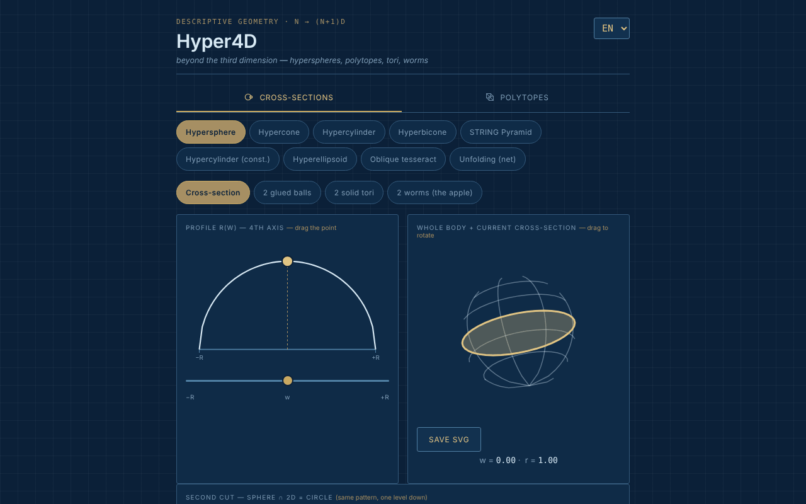

# Hyper4D

**English** · [Română](README.ro.md) · [Français](README.fr.md) · [Italiano](README.it.md) · [Español](README.es.md) · [Português](README.pt.md) · [Deutsch](README.de.md) · [Magyar](README.hu.md)

**Version:** 1.2.1 · **Last updated:** 2026-10-22

Interface languages: **Română, English, Français, Italiano, Español, Português (PT), Deutsch, Magyar**

An interactive explorer of geometry in the fourth dimension: cross-sections of hyperbodies and projections of regular polytopes.

**Live app:** https://chiuta.github.io/Hyper4D/

## What it is

Hyper4D is a single-file application (`index.html`, SVG + JavaScript, no libraries) for descriptive geometry "beyond the third dimension", in the style of a blue technical drawing. It has two categories: **Cross-sections** (what a 4D body looks like when cut by a 3D space, moving along the fourth axis) and **Polytopes** (4D → 3D → 2D projections rotated in real time).

## Features

- **Cross-sections:** hypersphere, hypercone, hypercylinder, double hypercone (bicone), "STRING Pyramid", hypercylinder (construction), hyperellipsoid, oblique tesseract, unfolding (net). The r(w) profile with a point dragged by the mouse, the whole body with the current section, the "second cut" (sphere ∩ 2D = circle).
- For the hypersphere, views: section, "2 glued balls", "2 solid tori", "2 worms (the apple)" with a selectable number of worms.
- For the oblique tesseract: cutting directions face / edge / vertex.
- **Polytopes:** 5-cell, 8-cell, 16-cell, 24-cell, 600-cell, 120-cell; duoprisms (3,3), (3,5) and custom (P,Q); pyramids over the cube, octahedron, dodecahedron, icosahedron; "star skeleton".
- Double 4D rotation (the XW and YZ planes), perspective or orthographic projection, pause/play, speed, "Solid faces".
- A title block with computed values (body, vertices·edges·faces — labelled V·M·F, S·A·F, V·E·F etc. depending on the language —, hypervolume V₄, the angles ∠XW and ∠YZ).
- Euler check for polytopes: `vertices − edges + faces − cells = 0`, with vertices and edges counted from the drawn geometry (including for the custom P×Q duoprism); for duoprisms the polygonal faces of the bases are counted too, not only the square ones from the title block. It is not shown for the star skeleton.
- Keyboard shortcuts for Polytopes: `P` or `Space` = pause/play, `←` `→` = previous/next shape (hint shown on the page, in 8 languages).
- Rotation by dragging with the mouse, zoom with the wheel or with two fingers.
- "Save SVG" button (for Polytopes and for "Whole body + current section"): downloads the current diagram as a standalone SVG file (the computed styles are copied into attributes, with the app's background), for papers or presentations; it is done locally, without a network.
- The polytope diagram now has a text alternative (`role="img"` with the body, V·M·F and a pointer to the title block), in 8 languages.
- Interface in 8 languages: EN (default), RO, FR, IT, ES, PT, DE, HU.
- The state (language, category, shape, view) is reflected in the URL hash, so it can be bookmarked or shared.

## New features (1.1.0)

Under **Polytopes**, below the diagram, a new row of buttons (in the app's 7 languages):
- **OBJ export (3D)**: the polytope's vertices in the 4D → 3D projection at the moment of pressing (the current double rotation and perspective/orthographic mode) and the edges as `l` lines. It opens in Blender, MeshLab etc. (pause the rotation so you know exactly what you are exporting). It does not export faces: it is only the lines (a skeleton).
- **JSON export (4D)**: the 4D coordinates (x, y, z, w), normalised to circumradius 1, the edges and faces as indices (from 0), plus the counts. Tested: 8-cell = 16/32/24, 600-cell = 120/720, 120-cell = 600/1200 etc.
- **QR code**: the code contains the app's public address (`https://chiuta.github.io/Hyper4D/`; when the page is served from another HTTPS host, the address of that page) plus the current state hash (language, category, shape, view). Useful for opening exactly the same view on a phone. The address can also be copied. Generated locally; it appears only if the QR module is in the file.
- **Printing**: the "Print" button (or Ctrl+P) now uses a stylesheet for paper: white background, dark lines, no tabs, buttons or selectors. Previously the dark theme was printed. The drawings remain those from the screen (the exact look of solid faces may differ from the browser's, depending on the printer).

The app's languages are EN, RO, FR, IT, ES, PT, DE, HU. The new translations in FR/IT/ES/PT/DE/HU are automatic, **not natively checked**.

## The "fff-kit"

Modules pasted into `index.html`: `core`, `label`, `bundle`, `qr`. "Transparency" opens from the version in the footer (network: 0 external requests; there are no keys in `localStorage`, so the backup is empty). Without the kit, the app works the same, but without the QR button.

## Tests

`node tests/fff-r8.test.mjs` (Playwright, network blocked; 41 checks): the OBJ export is compared independently with the 4D rotation computed from the JSON data and from the angles in the title block (orthographic and perspective), counts for 5-cell…120-cell and duoprisms, the tesseract's edge length, QR decoded back, labels in 8 languages, print mode (PDF), axe-core 0 violations (including the dialog, both categories), 360 px, without the kit.

## User guide

1. Choose the language from the selector in the corner of the header (EN / RO / FR / IT / ES / PT / DE / HU).
2. Choose the category: **Cross-sections** or **Polytopes**.
3. For sections: choose a body (for example "Hypersphere") and drag the point on the r(w) profile or move the `w` slider to travel along the fourth axis; drag the body to rotate it.
4. Tick "Show the cut toward 2D" (in the chosen language) for the second cut; for the hypersphere try the views "2 glued balls", "2 solid tori", "2 worms".
5. For polytopes: choose a 4D polyhedron, then "Pause"/"Play" for the rotation, the speed slider and "Solid faces" for solid faces; switch between perspective and orthographic projection.
6. For the custom duoprism choose the P and Q values from the lists.
7. Copy the address from the browser to share exactly the current state (hash `#lang=…&cat=…&shape=…`).

## Privacy and network

- I found in the code no local storage (not even in 1.1.0: the exports are files downloaded on request) (`localStorage`, `IndexedDB`), cookies or network calls (`fetch`/XHR); no external scripts, fonts or images are loaded.
- The navigation state is kept only in the URL hash (`replaceState`).
- The only `http` address in the file is the standard SVG namespace (`www.w3.org`), with no connection.

## Running locally / offline

Download `index.html` and open it in a browser; it works fully without internet (the app's footer says: "Offline tool, no external dependencies").

## History / Changelog

### 1.2.1 — 2026-10-22
- The label of the glued-balls zone (poles, equator, toward A/B) is now translated and updates when the language changes.

### 14 October 2026 (v1.1.0)
- New under Polytopes: OBJ and JSON export, QR code of the state, print stylesheet; the "Transparency" window (fff-kit: core, label, bundle, qr); `tests/fff-r8.test.mjs`. CSP: script hash recalculated.

### 12 October 2026 (v1.0.0)
- 1.0.0 — 2026-10-12: the version and the date of the last update are shown in the app

### 11 October 2026 (third entry)
- SVG saving for the polytope diagram and for the whole body + section.
- The rotating projection diagram is no longer `aria-hidden`: it has a text description (body, V·M·F), updated when the shape or the language changes.

### 11 October 2026 (second entry)
- Euler check (V − E + F − C = 0) for convex polytopes, keyboard shortcuts `P`/`Space` and `←`/`→`, the title-block label V·M·F translated into all 7 languages (in English "M" made no sense), new translations in 7 languages.
- CSP policy: `script-src` with a hash instead of `'unsafe-inline'`.

### 11 October 2026
- Accessibility: the work area is wrapped in <main>, the category bar became a `div` element with the `tablist` role (axe: 0 violations).
- Added a strict CSP (no network, no external resources).

## License

MIT for the app's code and structure — see the `LICENSE` file. Any third-party libraries included in the file keep their own licenses.

## Author

Alexio — Alexandru-Ionuț Chiuță, contact: alexio@trom.tf.
