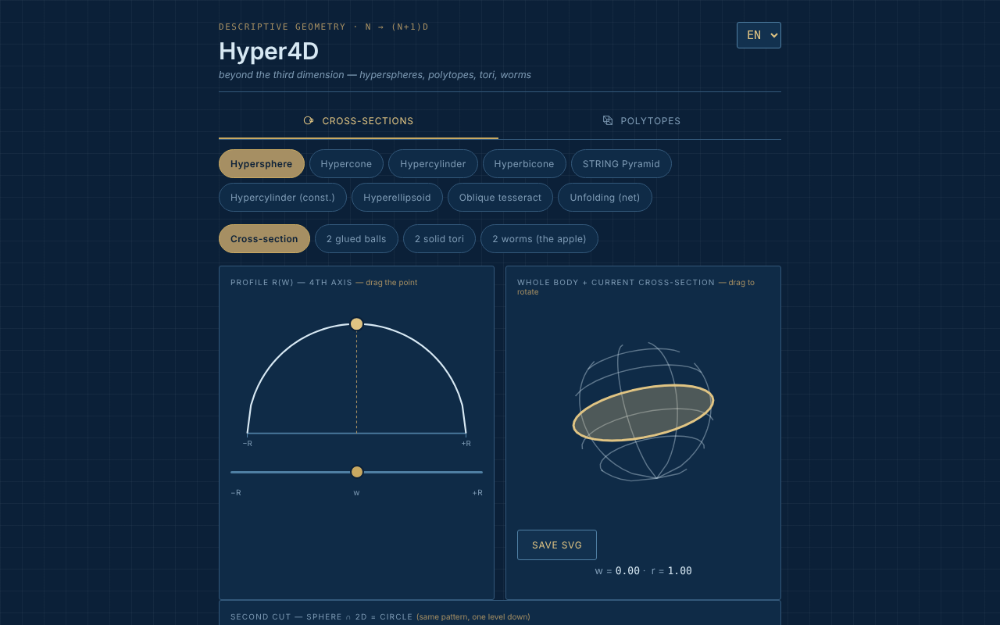

# Hyper4D

[English](README.md) · [Română](README.ro.md) · [Français](README.fr.md) · [Italiano](README.it.md) · [Español](README.es.md) · **Português** · [Deutsch](README.de.md) · [Magyar](README.hu.md)

**Versão:** 1.1.0 · **Última atualização:** 2026-10-14

Explorador interativo de geometria na quarta dimensão: secções de hipercorpos e projeções de politopos regulares.

**Aplicação online:** https://chiuta.github.io/Hyper4D/

## O que é

O Hyper4D é uma aplicação num único ficheiro (`index.html`, SVG + JavaScript, sem bibliotecas) para a geometria descritiva «para além da terceira dimensão», ao estilo de um desenho técnico azul. Tem duas categorias: **Secções transversais** (o aspeto de um corpo 4D cortado por um espaço 3D, percorrendo o quarto eixo) e **Politopos** (projeções 4D → 3D → 2D rodadas em tempo real).

## Funcionalidades

- **Secções transversais:** hiperesfera, hipercone, hipercilindro, hipercone duplo (bicone), «Pirâmide STRING», hipercilindro (construção), hiperelipsoide, teseracto oblíquo, planificação (net). O perfil r(w) com um ponto arrastado com o rato, o corpo inteiro com a secção atual, o «segundo corte» (esfera ∩ 2D = círculo).
- Para a hiperesfera, vistas: secção, «2 bolas coladas», «2 toros maciços», «2 vermes (a maçã)» com número de vermes selecionável.
- Para o teseracto oblíquo: direções de corte face / aresta / vértice.
- **Politopos:** 5-células, 8-células, 16-células, 24-células, 600-células, 120-células; duoprismas (3,3), (3,5) e (P,Q) personalizado; pirâmides sobre o cubo, o octaedro, o dodecaedro, o icosaedro; «star skeleton».
- Dupla rotação 4D (planos XW e YZ), projeção em perspetiva ou ortográfica, pausa/reprodução, velocidade, «Solid faces».
- Legenda com valores calculados (corpo, vértices·arestas·faces — etiquetados V·M·F, S·A·F, V·E·F etc., consoante o idioma —, hipervolume V₄, os ângulos ∠XW e ∠YZ).
- Verificação de Euler para os politopos: `vértices − arestas + faces − células = 0`, com os vértices e as arestas contados a partir da geometria desenhada (inclusive para o duoprisma personalizado P×Q); para os duoprismas contam-se também as faces poligonais das bases, e não apenas as quadradas da legenda. Não é apresentada para o esqueleto em estrela.
- Atalhos de teclado nos Politopos: `P` ou `Espaço` = pausa/reprodução, `←` `→` = forma anterior/seguinte (dica apresentada na página, em 7 idiomas).
- Rotação arrastando com o rato, zoom com a roda ou com dois dedos.
- Botão «Guardar SVG» (nos Politopos e em «Corpo inteiro + secção atual»): descarrega o diagrama atual como ficheiro SVG autónomo (os estilos calculados são copiados para atributos, com o fundo da aplicação), para trabalhos ou apresentações; faz-se localmente, sem rede.
- O diagrama do politopo tem agora uma alternativa de texto (`role="img"` com o corpo, V·M·F e uma remissão para a legenda), em 7 idiomas.
- Interface em 7 idiomas: EN (predefinido), RO, FR, IT, ES, PT, DE.
- O estado (idioma, categoria, forma, vista) reflete-se no hash do URL, pelo que pode ser guardado nos favoritos ou partilhado.

## Novidades (1.1.0)

Em **Politopos**, abaixo do diagrama, uma nova linha de botões (nos 7 idiomas da aplicação):
- **Exportação OBJ (3D)**: os vértices do politopo na projeção 4D → 3D no momento em que prime (a dupla rotação e o modo perspetiva/ortográfico atuais) e as arestas como linhas `l`. Abre-se no Blender, MeshLab, etc. (ponha a rotação em pausa para saber exatamente o que exporta). Não exporta faces: são apenas as linhas (esqueleto).
- **Exportação JSON (4D)**: as coordenadas 4D (x, y, z, w), normalizadas para o raio circunscrito 1, as arestas e as faces como índices (a partir de 0), mais as contagens. Testado: 8-células = 16/32/24, 600-células = 120/720, 120-células = 600/1200, etc.
- **Código QR**: o código contém o endereço público da aplicação (`https://chiuta.github.io/Hyper4D/`; quando a página é servida a partir de outro anfitrião HTTPS, o endereço dessa página) mais o hash de estado atual (idioma, categoria, forma, vista). Útil para abrir no telemóvel exatamente a mesma vista. Também é possível copiar o endereço. Gerado localmente; só aparece se o módulo QR estiver no ficheiro.
- **Impressão**: o botão «Imprimir» (ou Ctrl+P) usa agora uma folha de estilo para papel: fundo branco, linhas escuras, sem separadores, botões nem seletores. Antes era impresso o tema escuro. Os desenhos continuam a ser os do ecrã (o aspeto exato das faces maciças pode diferir do do navegador, consoante a impressora).

Os idiomas da aplicação continuam a ser EN, RO, FR, IT, ES, PT, DE (o húngaro não existe na aplicação; não acrescentei um idioma a meio). As novas traduções em FR/IT/ES/PT/DE são automáticas, **sem verificação nativa**.

## O kit «fff-kit»

Módulos colados em `index.html`: `core`, `label`, `bundle`, `qr`. A «Transparência» abre-se a partir da versão no rodapé (rede: 0 pedidos externos; não há chaves em `localStorage`, pelo que a cópia de segurança está vazia). Sem o kit, a aplicação funciona da mesma forma, mas sem o botão QR.

## Testes

`node tests/fff-r8.test.mjs` (Playwright, rede bloqueada; 41 verificações): a exportação OBJ é comparada de forma independente com a rotação 4D calculada a partir dos dados JSON e dos ângulos da legenda (ortográfica e perspetiva), contagens para 5-células…120-células e duoprismas, comprimento das arestas do teseracto, QR descodificado de volta, etiquetas em 7 idiomas, modo de impressão (PDF), axe-core 0 violações (incluindo a caixa de diálogo, ambas as categorias), 360 px, sem o kit.

## Manual de utilização

1. Escolha o idioma no seletor do canto do cabeçalho (EN / RO / FR / IT / ES / PT / DE).
2. Escolha a categoria: **Secções transversais** ou **Politopos**.
3. Nas secções: escolha um corpo (por exemplo «Hiperesfera») e arraste o ponto do perfil r(w) ou mova o controlo deslizante `w` para percorrer o quarto eixo; arraste o corpo para o rodar.
4. Assinale «Show the cut toward 2D» (no idioma escolhido) para o segundo corte; na hiperesfera experimente as vistas «2 bolas coladas», «2 toros maciços», «2 vermes».
5. Nos politopos: escolha um poliedro 4D e depois «Pause»/«Play» para a rotação, o controlo de velocidade e «Solid faces» para as faces maciças; alterne entre projeção em perspetiva e ortográfica.
6. Para o duoprisma personalizado, escolha os valores P e Q nas listas.
7. Copie o endereço do navegador para partilhar exatamente o estado atual (hash `#lang=…&cat=…&shape=…`).

## Privacidade e rede

- Não encontrei no código armazenamento local (nem sequer na 1.1.0: as exportações são ficheiros descarregados a pedido) (`localStorage`, `IndexedDB`), cookies nem chamadas de rede (`fetch`/XHR); não são carregados scripts, tipos de letra ou imagens externos.
- O estado de navegação é conservado apenas no hash do URL (`replaceState`).
- O único endereço `http` no ficheiro é o espaço de nomes SVG padrão (`www.w3.org`), sem ligação.

## Execução local / offline

Descarregue `index.html` e abra-o no navegador; funciona totalmente sem internet (o rodapé da aplicação diz: «Offline tool, no external dependencies»).

## Histórico / Changelog

### 14 de outubro de 2026 (v1.1.0)
- Novidade nos Politopos: exportação OBJ e JSON, código QR do estado, folha de estilo de impressão; janela «Transparência» (fff-kit: core, label, bundle, qr); `tests/fff-r8.test.mjs`. CSP: hash do script recalculado.

### 12 de outubro de 2026 (v1.0.0)
- 1.0.0 — 2026-10-12: a versão e a data da última atualização são apresentadas na aplicação

### 11 de outubro de 2026 (terceira entrada)
- Gravação SVG para o diagrama do politopo e para o corpo inteiro + secção.
- O diagrama da projeção rotativa deixou de ser `aria-hidden`: tem uma descrição de texto (corpo, V·M·F), atualizada ao mudar a forma ou o idioma.

### 11 de outubro de 2026 (segunda entrada)
- Verificação de Euler (V − E + F − C = 0) para os politopos convexos, atalhos de teclado `P`/`Espaço` e `←`/`→`, etiqueta V·M·F da legenda traduzida para os 7 idiomas (em inglês «M» não fazia sentido), novas traduções em 7 idiomas.
- Política CSP: `script-src` com hash em vez de `'unsafe-inline'`.

### 11 de outubro de 2026
- Acessibilidade: a zona de trabalho foi envolvida em <main>, a barra de categorias passou a ser um elemento `div` com a função `tablist` (axe: 0 violações).
- Adicionada uma CSP estrita (sem rede, sem recursos externos).

## Licença

MIT para o código e a estrutura da aplicação — ver o ficheiro `LICENSE`. As eventuais bibliotecas de terceiros incluídas no ficheiro mantêm as suas próprias licenças.

## Autor

Alexio — Alexandru-Ionuț Chiuță, contacto: alexio@trom.tf.

## Resumo em inglês

O Hyper4D é um explorador SVG/JavaScript num único ficheiro da geometria a quatro dimensões: secções de hiperesferas, hipercones, hipercilindros, do teseracto oblíquo e mais, além de projeções 4D → 3D → 2D rotativas de politopos regulares (do 5-células ao 120-células), duoprismas e pirâmides. Interface em 7 idiomas, sem armazenamento, sem rede. Licença MIT.

Novidades na 1.1.0 (Politopos): exportação OBJ da projeção 3D atual (estrutura de arame), exportação JSON dos vértices/arestas/faces 4D, código QR da vista atual (endereço público + hash de estado; gerado localmente) e uma folha de estilo de impressão adequada ao papel. Os 7 idiomas da interface mantêm-se (sem húngaro); as novas cadeias em FR/IT/ES/PT/DE são traduzidas automaticamente e não foram verificadas por falantes nativos.
