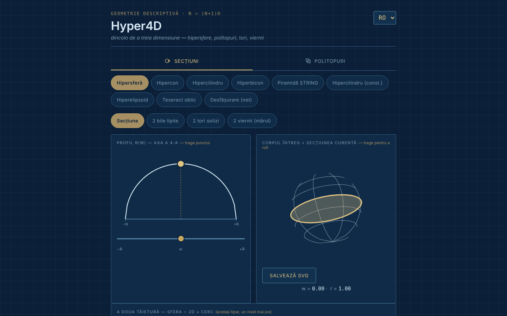

# Hyper4D

[English](README.md) · **Română** · [Français](README.fr.md) · [Italiano](README.it.md) · [Español](README.es.md) · [Português](README.pt.md) · [Deutsch](README.de.md) · [Magyar](README.hu.md)

**Versiune:** 1.2.1 · **Ultima actualizare:** 2026-10-22

Limbile interfeței: **Română, English, Français, Italiano, Español, Português (PT), Deutsch, Magyar**

Explorator interactiv de geometrie în a patra dimensiune: secțiuni ale hipercorpurilor și proiecții ale politopilor regulați.

**Live:** https://chiuta.github.io/Hyper4D/

## Ce este

Hyper4D este o aplicație single-file (`index.html`, SVG + JavaScript, fără biblioteci) pentru geometria descriptivă „dincolo de a treia dimensiune”, în stilul unui desen tehnic albastru. Are două categorii: **Secțiuni transversale** (cum arată un corp 4D tăiat de un spațiu 3D, parcurgând a patra axă) și **Politopi** (proiecții 4D → 3D → 2D rotite în timp real).

## Funcții

- **Secțiuni transversale:** hipersferă, hipercon, hipercilindru, hipercon dublu (bicon), „Piramida STRING”, hipercilindru (construcție), hiperelipsoid, tesseract oblic, desfășurare (net). Profilul r(w) cu punct tras de mouse, corpul întreg cu secțiunea curentă, „a doua tăietură” (sferă ∩ 2D = cerc).
- Pentru hipersferă, vizualizări: secțiune, „2 bile lipite”, „2 tori plini”, „2 viermi (mărul)” cu număr de viermi selectabil.
- Pentru tesseractul oblic: direcții de tăiere față / muchie / vârf.
- **Politopi:** 5-cell, 8-cell, 16-cell, 24-cell, 600-cell, 120-cell; duoprisme (3,3), (3,5) și (P,Q) personalizat; piramide peste cub, octaedru, dodecaedru, icosaedru; „star skeleton”.
- Rotație dublă 4D (planurile XW și YZ), proiecție în perspectivă sau ortografică, pauză/redare, viteză, „Solid faces”.
- Cartuș cu valori calculate (corp, vârfuri·muchii·fețe — etichetată V·M·F, S·A·F, V·E·F etc. după limbă —, hipervolum V₄, unghiurile ∠XW și ∠YZ).
- Verificare Euler pentru politopi: `vârfuri − muchii + fețe − celule = 0`, cu vârfurile și muchiile numărate din geometria desenată (inclusiv pentru duoprisma personalizată P×Q); pentru duoprisme se numără și fețele poligonale ale bazelor, nu doar cele pătrate din cartuș. Nu se afișează pentru scheletul-stea.
- Scurtături de tastatură la Politopi: `P` sau `Spațiu` = pauză/redare, `←` `→` = forma anterioară/următoare (indiciu afișat în pagină, în 8 limbi).
- Rotire prin tragere cu mouse-ul, zoom cu rotița sau cu două degete.
- Buton „Salvează SVG” (la Politopi și la „Corp întreg + secțiune curentă”): descarcă diagrama curentă ca fișier SVG autonom (stilurile calculate sunt copiate în atribute, cu fundalul aplicației), pentru lucrări sau prezentări; se face local, fără rețea.
- Diagrama politopului are acum alternativă text (`role="img"` cu corp, V·M·F și trimitere la cartuș), în 8 limbi.
- Interfață în 8 limbi: EN (implicit), RO, FR, IT, ES, PT, DE, HU.
- Starea (limbă, categorie, formă, vizualizare) se reflectă în hash-ul URL-ului, deci poate fi pusă la semn sau partajată.

## Funcții noi (1.1.0)

La **Politopuri**, sub diagramă, un rând nou de butoane (în cele 7 limbi ale aplicației):
- **Export OBJ (3D)**: vârfurile politopului în proiecția 4D → 3D de la momentul apăsării (rotația dublă și modul perspectivă/ortografic curente) și muchiile ca linii `l`. Se deschide în Blender, MeshLab ș.a. (pune rotația în pauză ca să știi exact ce exporți). Nu exportă fețe: sunt doar liniile (schelet).
- **Export JSON (4D)**: coordonatele 4D (x, y, z, w), normalizate la raza circumscrisă 1, muchiile și fețele ca indici (de la 0), plus numărătorile. Testat: 8-cell = 16/32/24, 600-cell = 120/720, 120-cell = 600/1200 etc.
- **Cod QR**: codul conține adresa publică a aplicației (`https://chiuta.github.io/Hyper4D/`; când pagina e servită de pe alt gazdă HTTPS, adresa acelei pagini) plus hash-ul de stare curent (limbă, categorie, formă, vizualizare). Util ca să deschizi pe telefon exact aceeași vedere. Se poate și copia adresa. Generat local; apare doar dacă modulul QR e în fișier.
- **Tipărire**: butonul „Tipărește” (sau Ctrl+P) folosește acum o foaie de stil pentru hârtie: fundal alb, linii închise la culoare, fără file, butoane și selectoare. Înainte se tipărea tema întunecată. Desenele rămân cele de pe ecran (aspectul exact al fețelor pline poate diferi de cel din browser, în funcție de imprimantă).

Limbile aplicației sunt EN, RO, FR, IT, ES, PT, DE, HU. Traducerile noi în FR/IT/ES/PT/DE/HU sunt automate, **neverificate nativ**.

## Kit „fff-kit”

Module lipite în `index.html`: `core`, `label`, `bundle`, `qr`. „Transparență” se deschide din versiunea din subsol (rețea: 0 cereri externe; nu există chei în `localStorage`, deci copia de siguranță este goală). Fără kit, aplicația funcționează la fel, dar fără butonul QR.

## Teste

`node tests/fff-r8.test.mjs` (Playwright, rețea blocată; 41 de verificări): exportul OBJ este comparat independent cu rotația 4D calculată din datele JSON și din unghiurile din cartuș (ortografic și perspectivă), numărători pentru 5-cell…120-cell și duoprisme, lungimea muchiilor teseractului, QR decodat înapoi, etichete în 8 limbi, mod tipărire (PDF), axe-core 0 violări (inclusiv dialog, ambele categorii), 360 px, fără kit.

## Manual de utilizare

1. Alege limba din selectorul din colțul antetului (EN / RO / FR / IT / ES / PT / DE / HU).
2. Alege categoria: **Secțiuni transversale** sau **Politopi**.
3. La secțiuni: alege un corp (de exemplu „Hipersferă”) și trage punctul de pe profilul r(w) sau mută sliderul `w` pentru a parcurge a patra axă; trage corpul pentru a-l roti.
4. Bifează „Show the cut toward 2D” (în limba aleasă) pentru a doua tăietură; pentru hipersferă încearcă vizualizările „2 bile lipite”, „2 tori plini”, „2 viermi”.
5. La politopi: alege un poliedru 4D, apoi „Pause”/„Play” pentru rotație, sliderul de viteză și „Solid faces” pentru fețe pline; comută între proiecție în perspectivă și ortografică.
6. Pentru duoprisma personalizată alege valorile P și Q din liste.
7. Copiază adresa din browser pentru a partaja exact starea curentă (hash `#lang=…&cat=…&shape=…`).

## Confidențialitate și rețea

- Nu am găsit în cod stocare locală (nici în 1.1.0: exporturile sunt fișiere descărcate la cerere) (`localStorage`, `IndexedDB`), cookie-uri sau apeluri de rețea (`fetch`/XHR); nu se încarcă scripturi, fonturi sau imagini externe.
- Starea de navigare e păstrată doar în hash-ul URL-ului (`replaceState`).
- Singura adresă `http` din fișier este spațiul de nume SVG standard (`www.w3.org`), fără conexiune.

## Rulare locală / offline

Descarcă `index.html` și deschide-l în browser; funcționează complet fără internet (subsolul aplicației spune: „Offline tool, no external dependencies”).

## Istoric / Changelog

### 1.2.1 — 2026-10-22
- Eticheta zonei bilelor lipite (poli, ecuator, spre A/B) este acum tradusă și se actualizează la schimbarea limbii.

### 14 octombrie 2026 (v1.1.0)
- Nou la Politopuri: export OBJ și JSON, cod QR al stării, foaie de stil de tipărire; fereastra „Transparență” (fff-kit: core, label, bundle, qr); `tests/fff-r8.test.mjs`. CSP: hash-ul scriptului recalculat.

### 12 octombrie 2026 (v1.0.0)
- 1.0.0 — 2026-10-12: versiunea și data ultimei actualizări sunt afișate în aplicație

### 11 octombrie 2026 (a treia intrare)
- Salvare SVG pentru diagrama politopului și pentru corpul întreg + secțiune (7 limbi).
- Diagrama proiecției rotative nu mai este `aria-hidden`: are descriere text (corp, V·M·F), actualizată la schimbarea formei sau a limbii.

### 11 octombrie 2026 (a doua intrare)
- Verificare Euler (V − E + F − C = 0) pentru politopii convecși, scurtături de tastatură `P`/`Spațiu` și `←`/`→`, eticheta cartușului V·M·F tradusă în cele 7 limbi (în engleză „M” nu avea sens), traduceri noi în 7 limbi.
- Politica CSP: `script-src` cu hash în loc de `'unsafe-inline'`.

### 11 octombrie 2026
- Accesibilitate: zona de lucru încadrată în <main>, bara de categorii a devenit un element `div` cu rol `tablist` (axe: 0 violări).
- Adăugat CSP strict (fără rețea, fără resurse externe).

## Licență

MIT pentru codul și structura aplicației — vezi fișierul `LICENSE`. Eventualele biblioteci terțe incluse în fișier își păstrează licențele proprii.

## Autor

Alexio — Alexandru-Ionuț Chiuță, contact: alexio@trom.tf.

## Rezumat

Hyper4D este un explorator SVG/JavaScript într-un singur fișier al geometriei în patru dimensiuni: secțiuni prin hipersfere, hiperconuri, hipercilindri, tesseract oblic și altele, plus proiecții rotative 4D–3D–2D ale politopilor regulați (5-celule până la 120-celule), duoprisme și piramide. 8 limbi de interfață, fără stocare, fără rețea. Licență MIT.

Noutăți în 1.1.0 (Politopi): export OBJ al proiecției 3D curente (schelet de linii), export JSON al vârfurilor/muchiilor/fețelor 4D, un cod QR pentru vizualizarea curentă (adresa publică + hash al stării; generat local) și o foaie de stil prietenoasă cu tipărirea. 8 limbi de interfață (inclusiv maghiara); textele noi în FR/IT/ES/PT/DE/HU sunt traduse automat și nu au fost verificate de vorbitori nativi.
